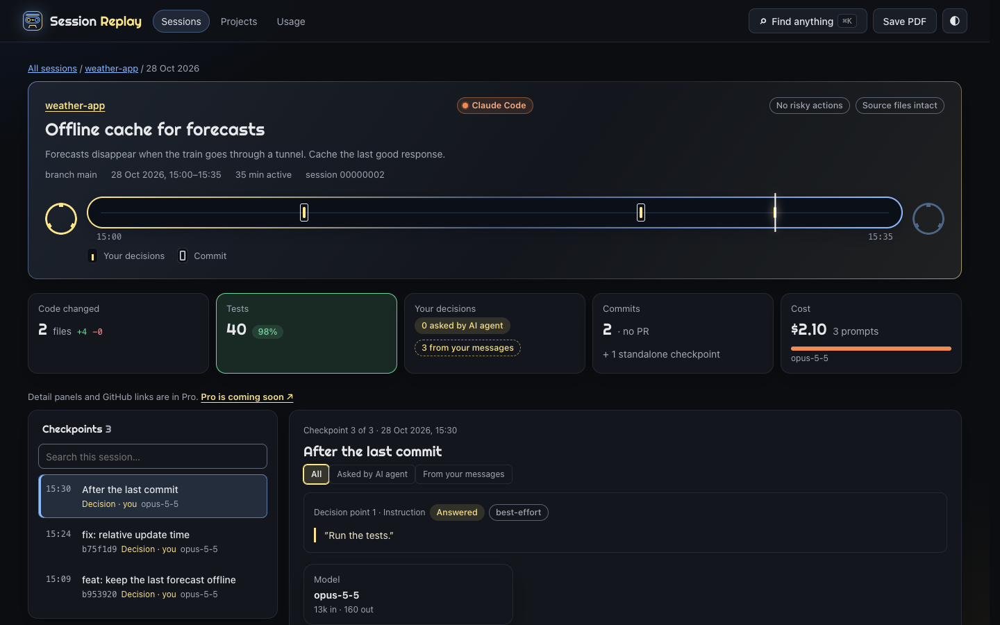
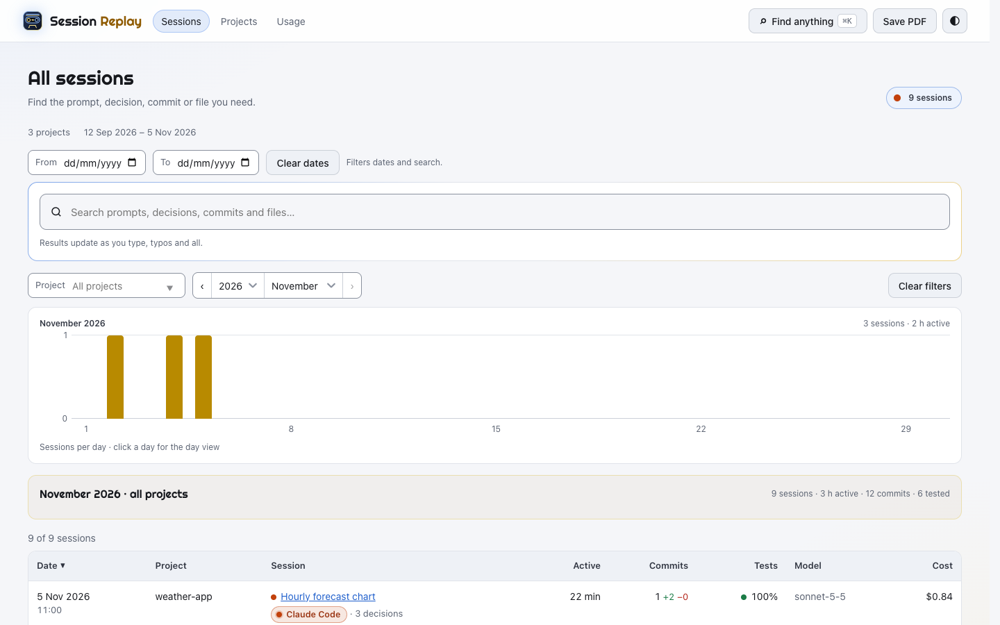
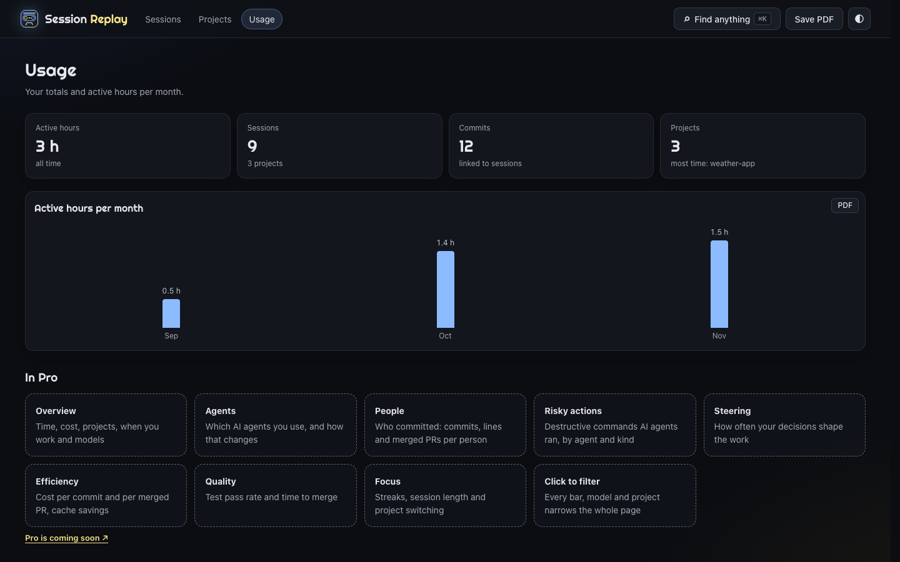
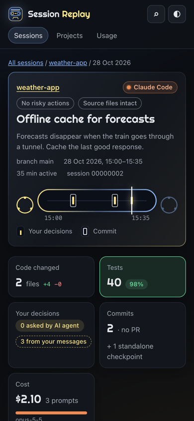

# Session Replay

Private, searchable replays of your Claude Code sessions. Find the prompt, decision or commit behind any change, in any project.



> [!IMPORTANT]
> Needs Node.js 24 or newer. Check with `node --version`. To install it, go to [nodejs.org](https://nodejs.org) or run `brew install node`.

> [!NOTE]
> Everything stays on your Mac and nothing leaves it. No account, no tracking, and the pages load nothing from the internet.

## Install

In Claude Code, run:

```
/plugin marketplace add nrajesh/session-replay
/plugin install session-replay@session-replay
```

Then start a new Claude Code session. Your pages build in the background and live here:

```
~/.local/share/session-replay/replays/index.html
```

They update by themselves whenever a Claude Code session starts or ends. To update right now, type
`/session-replay:update` or ask Claude “update my session replays”.

## What you get

- **Search everything.** Prompts, decisions, commits and files across all your projects, typos and all.
- **Replay a session.** A timeline of checkpoints with your decisions, the tests that ran and the commits that came out of it.
- **See your history.** Calendar, day view and a month-by-month list of what shipped.
- **Know your usage.** Active hours, sessions, commits and a monthly chart.
- **Keep a copy.** Sessions stay in your archive even after Claude Code cleans up old transcripts. Save any page as a PDF.

<details>
<summary>More screenshots</summary>

All sessions, with search and the activity chart:



Usage:



On a phone:



</details>

## Free and Pro

| | Free | Pro |
|---|---|---|
| Sessions it reads | Claude Code | Claude Code, Codex and Copilot, from several folders |
| Find anything | Search every project, typos and all | Same |
| Replay a session | Tape, checkpoints, hover cards | Plus detail panels |
| Calendar and timeline | Calendar, day view, releases | Same |
| Your usage | Totals and a monthly chart | Hours, tokens and cost by project and agent; how often you steered |
| Ask questions | — | Ask why, get a dated story with its sources |
| GitHub | — | PRs and cloud sessions, any account |
| Export | PDF | PDF, Excel and CSV |
| Runs | Updates after every Claude Code session | Also runs in the background, settings in your browser |
| Price | Free, open source (MIT) | Coming soon: one-time, early-access price |

## Pro

Pro is coming soon, with a one-time price and an early-access discount. Want it? Comment on [Pro early access](https://github.com/nrajesh/session-replay/discussions/1) and you will hear first.

## Settings

Most people never need these. To change one, ask Claude, for example: “set my Session Replay theme to dark”.

<details>
<summary>All settings</summary>

| Setting | What it does | Ask Claude |
|---|---|---|
| `theme` | Light, dark or follow your Mac | “set my Session Replay theme to dark” |
| `archiveDays` | How long to keep sessions (0 = forever) | “keep Session Replay sessions for 365 days” |
| `excludeProjects` | Projects to leave out | “leave the scratch project out of Session Replay” |
| `includeProjects` | Only show these projects | “only show my-app in Session Replay” |
| `extraRedactions` | Extra text to hide, as patterns | “hide text matching acme-[0-9]+ in Session Replay” |
| `projectsDir` | A different Claude Code projects folder | “use ~/work/.claude/projects for Session Replay” |

Ask “where are my session replays?” to see where the pages are and how many sessions they hold.

</details>

## What it reads, writes and runs

<details>
<summary>The details</summary>

- **Reads** your Claude Code transcripts in `~/.claude/projects` (or `$CLAUDE_CONFIG_DIR/projects`), read-only.
- **Runs** `git` read-only in your project folders, to link sessions to commits and releases.
- **Writes** pages and a cache to `~/.local/share/session-replay/` (or `$XDG_DATA_HOME/session-replay/`). Delete that folder to remove everything.
- **Starts** from Claude Code's SessionStart and SessionEnd hooks, and when you ask for an update. Each run is short and works in the background.
- **Sends** nothing anywhere. There are no network calls, analytics or accounts.
- **Hides** common secrets (API keys, tokens) before writing pages.

</details>

## Feedback

Found a bug or have an idea? Open an [issue](https://github.com/nrajesh/session-replay/issues) or start a [discussion](https://github.com/nrajesh/session-replay/discussions).

## Licence

MIT. See [LICENSE](LICENSE).
